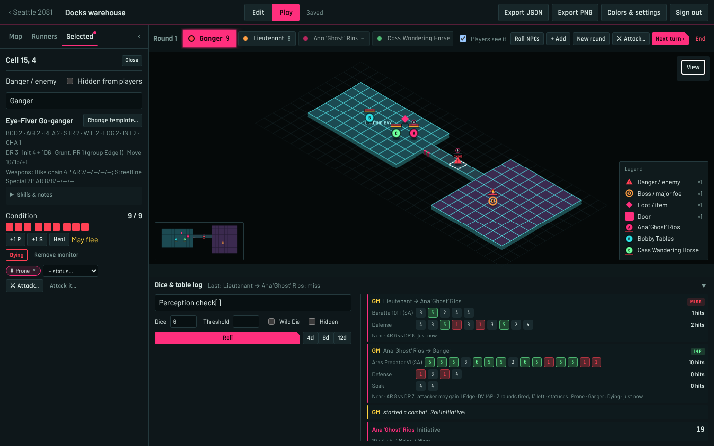
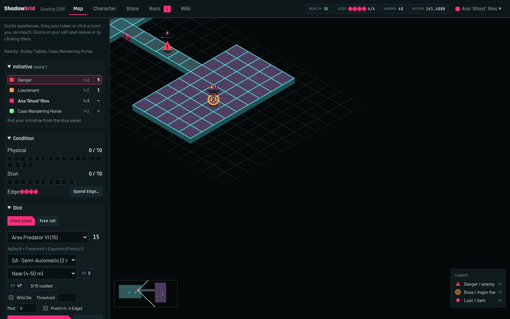
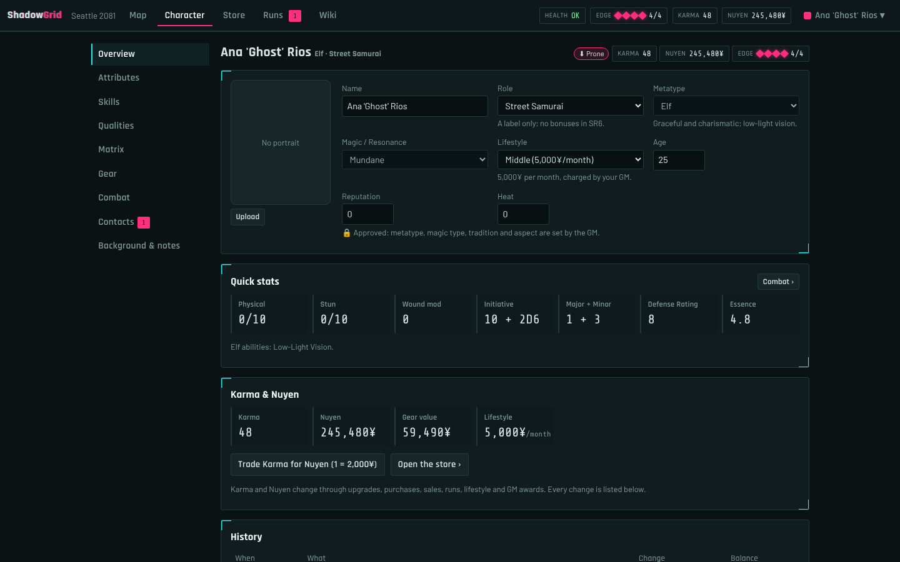
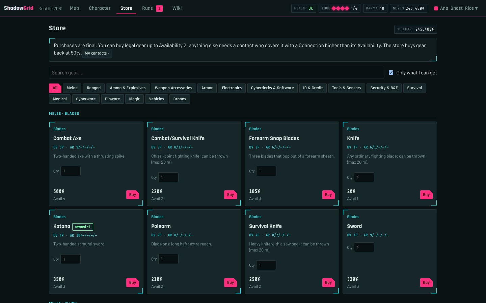
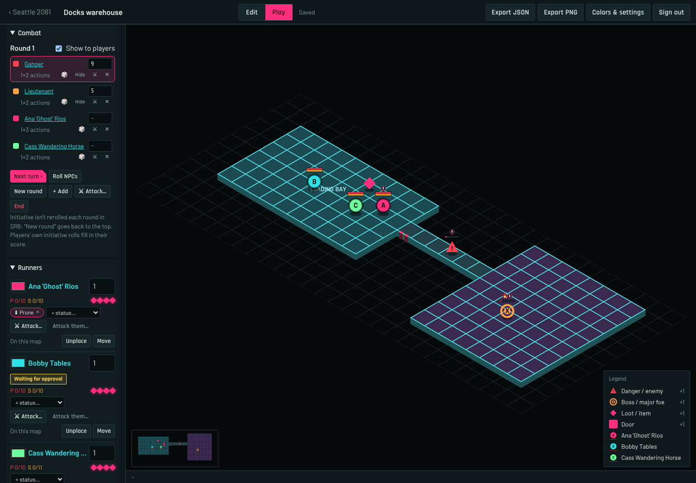
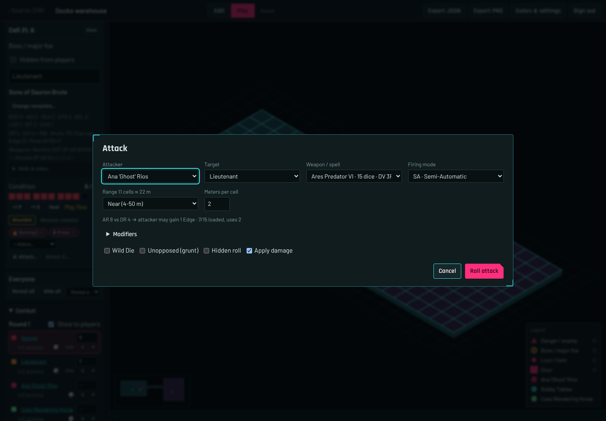
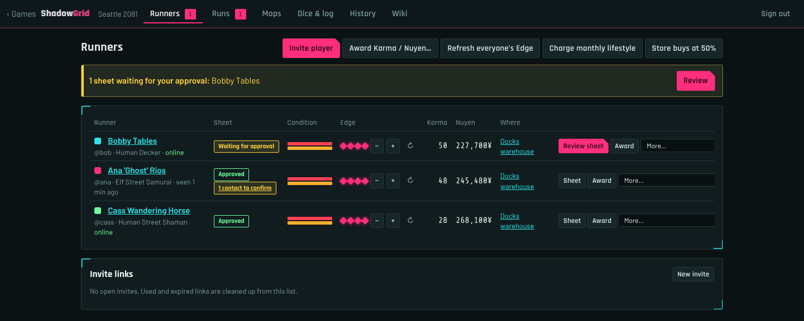

# ShadowGrid

A self-hosted web app for running a **Shadowrun Sixth World** table. The game
master builds fog-of-war maps and hands out contracts. Players manage their
character sheets, explore the map, and roll dice with Edge. Everything stays in
sync live in the browser.



**[Read the user guide →](docs/index.html)** for a walkthrough for players and
game masters, with screenshots.

## What it does

- **Core-book data.** Every weapon, armor, implant, vehicle, drone, piece of
  gear, spell, ritual, adept power, quality, spirit, complex form and NPC from
  the Sixth World core rulebook, with its Availability and price.
- **Character sheets** with metatype maximums and abilities, derived attributes,
  skills with specializations and expertise, knowledge skills and languages,
  qualities, magic (spells, powers, foci, spirits, initiation), resonance
  (complex forms, sprites, submersion), Matrix stats, gear, contacts and
  background.
- **Approval workflow.** Players build freely while their sheet is a draft. The
  GM approves it, and from then on upgrades cost Karma and purchases are final.
- **Store gated by contacts.** Players see what their contacts can source. A
  contact covers some kinds of goods and finds items with an Availability below
  their Connection. Implants come in grades, ammo is sold by the box, and gear
  can be sold back at a percentage the GM sets.
- **Automatic ammo**: attacks spend rounds by firing mode, and grenades are used
  up when thrown.
- **Fog-of-war maps** on square or hex grids, drawn by hand or generated. Each
  player sees only what their runner has explored, and doors block movement and
  sight.
- **Isometric view** in the style of the SNES Shadowrun, or a flat top-down
  view. Toggle with <kbd>I</kbd>.
- **SR6 dice roller**: pools from the sheet, hits and glitches, thresholds, the
  Wild Die, Edge Boosts, firing modes and ranges, and drain or fading after
  casting. Every roll goes to a shared table log, and the GM can make hidden
  rolls.
- **Combat**: an initiative tracker the GM can show to players (hidden enemies
  stay hidden until revealed), actions per round, and attacks resolved by the
  server: attack, defense, damage, soak, overflow, knockdown and elemental
  effects.
- **NPCs** from the core-book templates by Professional Rating, critters and
  spirits of any Force, with grunt condition monitors.
- **Statuses** such as Prone, Burning or Zapped, set by the GM and shown as icons
  on the map.
- **Healing** with first aid, medkits, magic and natural recovery, per the book.
- **Runs (contracts)**: the GM assigns tasks and runners, ticks tasks as they
  happen, and closes the run. Each runner is paid automatically.
- **GM tools**: invite links, Karma and nuyen awards, Edge refresh, monthly
  lifestyle charges (nuyen can go negative), a full history of every Karma and
  nuyen change, snapshots of the map state, and a searchable rules wiki.

| | |
|---|---|
|  |  |
| Players see only what their runner has explored. | The character sheet. |
|  |  |
| The store, filtered by the player's contacts. | The GM's initiative tracker. |
|  |  |
| Resolving an attack. | The GM's runners table, with a sheet waiting for approval. |

## Quick start

Requires Python 3.9 or newer.

```bash
pip install -r requirements.txt
python app.py
```

On first start the console prints the game master account:

```
Username: admin
Password: <generated>      <- save it now, it is not shown again
```

Open http://127.0.0.1:5000 and sign in as `admin`. Create a game, add a map,
then use **Invite player** to send each player a single-use link. Their account
only opens that game.

Change the GM password any time:

```bash
python app.py set-password
# or force it at startup:
GRIDMAP_ADMIN_PASSWORD='long random string' python app.py
```

## Running on the internet

Use `serve.py` (waitress) behind a reverse proxy that terminates TLS, such as
nginx or Caddy:

```bash
GRIDMAP_HTTPS=1 GRIDMAP_TRUST_PROXY=1 GRIDMAP_PORT=8000 python serve.py
```

| Variable | Meaning |
|---|---|
| `GRIDMAP_DB` | SQLite database path (default `shadowgrid.db` next to `app.py`) |
| `GRIDMAP_HTTPS=1` | Secure cookies. Only set it when the site is really served over https |
| `GRIDMAP_TRUST_PROXY=1` | Rate limits read `X-Forwarded-For`. Only set it behind your own proxy |
| `GRIDMAP_HOST` / `GRIDMAP_PORT` | Bind address |
| `GRIDMAP_ADMIN_PASSWORD` | Sets the GM password at startup |
| `GRIDMAP_LOGIN_POW_BITS` | Proof-of-work difficulty of the sign-in and invite forms (default 13) |
| `GRIDMAP_SERVER_IDENT` | `Server` response header (default `nginx`) |

Example nginx location:

```
location / {
    proxy_pass http://127.0.0.1:8000;
    proxy_set_header X-Forwarded-For $remote_addr;
    proxy_set_header Host $host;
}
```

Security measures:
- Passwords are hashed, and sessions use signed HttpOnly cookies.
- Every write needs a CSRF header.
- The sign-in and invite forms require a proof of work.
- Requests are rate-limited per player.
- A strict Content Security Policy is applied.
- Fog of war is filtered on the server: a player's browser never receives
  unexplored parts of the map.

## Rules implemented

- **Dice:**
  - A 5 or 6 is a hit.
  - A glitch is when more than half of the dice show 1; a critical glitch is a
    glitch with no hits.
  - The threshold is optional: the roll succeeds when hits reach it.
  - Wound modifiers are applied automatically.
  - An untrained skill rolls the attribute −1. A specialization adds +2 and an
    expertise +3.
- **Wild Die:** a 5 or 6 counts as 3 hits; a 1 cancels the 5s in the roll.
- **Edge Boosts**, one per roll:
  - Before rolling: 4 Edge adds your Edge rating to the pool, with exploding
    6s.
  - After rolling: 1 Edge per die rerolls the selected dice, 2 Edge adds +1 to
    one die, 3 Edge buys a hit, and 4 Edge rerolls every failed die.
  - Outside rolls: +3 Initiative for 1 Edge, healing 1 Stun for 3 or 1 Physical
    for 4, giving an ally 1 Edge for 2, and the narrative boosts.
  - Edge is capped at 7, and only the GM refreshes or awards it. Edge from
    Attack Rating against Defense Rating is shown but awarded by hand.
- **Combat:**
  - Firing modes: single shot 1 round, semi-auto 2 (−2 AR, +1 DV), burst 4
    (−4 AR, +2 DV), full auto 10 (−6 AR).
  - Ties go to the attacker. DV = weapon DV + net hits, soaked with Body; direct
    spells can't be soaked. Damage after soaking above Body knocks the target
    down.
  - 1 Major and 1 + Initiative Dice Minor actions (5 at most). Initiative is not
    rerolled between rounds.
  - Grunts have one monitor, −1 die per 2 boxes, and may flee once damage
    exceeds their Professional Rating.
- **Condition monitors:**
  - Physical is 8 + Body/2 and Stun is 8 + Willpower/2, rounded up.
  - −1 die for every 3 boxes filled on each track.
  - A full Stun track means unconscious, and further Stun overflows into
    Physical one for one.
  - A full Physical track means dying, with overflow boxes equal to Body × 2.
- **Magic and resonance:** drain is resisted with Willpower + the tradition
  attribute, fading with Willpower + Logic; either is Physical when its value
  is above Magic or Resonance. Every point of Essence lost lowers Magic and
  Resonance by 1.
- **Healing:** first aid and medkits test against 5 − Essence, once per set of
  injuries; natural recovery rolls Body + Willpower per hour (Stun) or
  Body + Body per day (Physical). Drain can't be healed by first aid or magic.
- **Availability:** up to 6 during creation. After approval, legal items up to
  2 are always available; everything else needs a confirmed contact who covers
  that kind of goods with a higher Connection.
- **Advancement after approval:**
  - Raising an attribute or skill costs the new rating × 5 Karma.
  - A specialization or expertise costs 5, a knowledge skill 3, a spell or
    complex form 5, and a positive quality twice its cost.
  - Initiation or submersion costs 10 + the new grade.
  - Bonding a focus costs Force × its type multiplier in Karma.
  - Karma trades for nuyen at 1 = 2,000¥.

## Project layout

- `app.py`: sign-in, invite pages, page routes, CLI
- `core.py`: app setup, database schema, shared helpers, player auth
- `maps.py`: map editor API, fog of war, doors, markers, snapshots, and the
  player map view
- `game.py`: games, invites, accounts, character sheets, dice and Edge, runs,
  awards, lifestyle and healing
- `fight.py`: initiative tracker, attacks, statuses and NPC templates
- `sr/core6e.py`, `sr/gear6e.py`, `sr/magic6e.py`, `sr/npc6e.py`: core-book
  data (metatypes, skills, qualities, gear, magic, resonance, NPCs)
- `sr/catalog.py`: store catalog, ratings and grades, Availability and contact
  access
- `sr/rules.py`: character model, derived stats, sheet actions, pools and the
  Karma and nuyen economy
- `sr/combat.py`: NPCs from templates and attack resolution
- `sr/wiki.py`: the rules wiki
- `sr/dice.py`: SR6 dice engine
- `security.py`: auth decorators, proof of work, rate limits, security headers
- `geometry.py`: grid adjacency, door blocking, line-of-sight reveal
- `static/`: front end, with no build step. The main files are:
  - `play.js`: the player app
  - `sheet.js`: the character sheet
  - `editor.js`: the GM map editor
  - `gamepage.js`: the GM game dashboard
  - `gridcore.js`: the map renderer
  - `srui.js`: the dice and condition widgets
  - `fonts/`: self-hosted OFL fonts with their licenses
- `templates/`: HTML pages
- `docs/`: user guide and screenshots
- `smoke_test.py`: end-to-end API test. Run it with `python smoke_test.py`

## License notes

The fonts Rajdhani, Barlow and Share Tech Mono are used under the SIL Open Font
License; see `static/fonts/`.

*Shadowrun is a trademark of Catalyst Game Labs and The Topps Company. This is
an unofficial fan project, not affiliated with or endorsed by them.*
