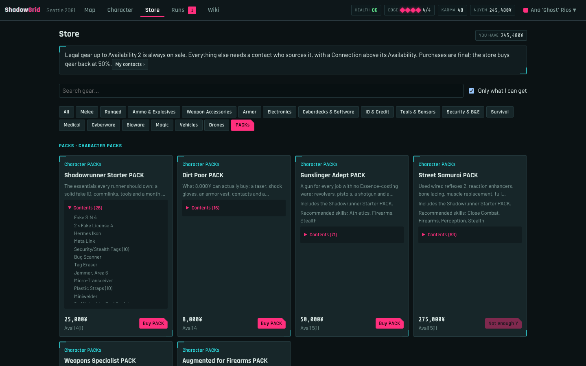
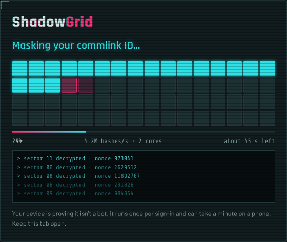
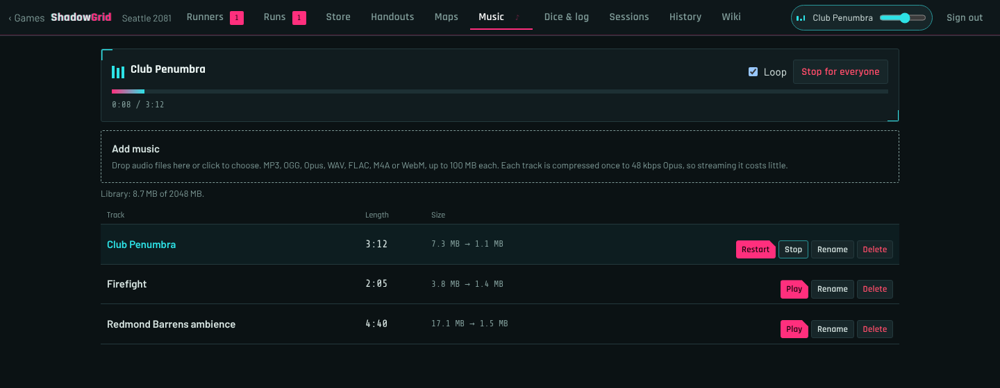

# ShadowGrid

A self-hosted web app for running a **Shadowrun Sixth World** table. The game
master builds fog-of-war maps, hands out contracts and handouts, and runs
combat. Players manage their character sheets, explore the map and roll dice
with Edge. Every change shows up live in everyone's browser.


**[Read the user guide →](docs/index.html)** for a walkthrough for players and
game masters, with screenshots.

## What it does

- **Core-book data.** Every weapon, armor, implant, vehicle, drone, piece of
  gear, spell, ritual, adept power, quality, spirit, complex form and NPC from
  the Sixth World core rulebook, with its Availability and price.
- **Sixth World Companion content** that works with the core rules: 20
  metavariants and 5 metasapients, the 18 Infected (HMHVV) expressions with
  their powers and weaknesses, metagenic (changeling) and other new qualities
  with their effects calculated on the sheet, contact archetypes, and 177 gear
  PACKs in the store and the wiki. The Companion's optional rules are not used.
- **Character sheets** with metatype maximums and abilities, derived attributes,
  skills with specializations and expertise, knowledge skills and languages,
  qualities, magic (spells, sustained spells, powers, foci, spirits,
  initiation), resonance (complex forms, sprites, submersion), the Matrix
  (devices, programs, Overwatch Score), vehicles and drones, gear, contacts,
  Reputation and Heat, and background.
- **Character files.** Players can export their sheet to a file and import it
  into a draft. The GM can do the same for any runner.
- **Printable sheets.** A two-page sheet of your runner to print or save as a
  PDF, or a blank sheet to fill in by hand.
- **Approval workflow.** Players build freely while their sheet is a draft. The
  GM approves it, and from then on upgrades cost Karma and purchases are final.
- **Store gated by contacts.** Players see what their contacts can source. A
  contact's type (fixer, arms dealer, street doc…) covers some kinds of goods,
  and they find items with an Availability below their Connection. Implants
  come in grades, ammo is sold by the box, and gear can be sold back at a
  percentage the GM sets. PACKs are bought in one go, item by item checked
  against the player's contacts. The GM marks items out of stock (and back)
  from the game's Store tab.
- **A map-first play screen** for players and the GM: the map fills the
  screen, the initiative order runs in a strip above it, the dice roller and
  table log sit in a collapsible panel below, and everything else is in a
  tabbed side panel. <kbd>[</kbd> and <kbd>]</kbd> hide the side panel and the
  dice.
- **Fog-of-war maps** on square or hex grids, drawn by hand or generated. Each
  player sees only what their runner has explored, and doors block movement and
  sight. Players right-click markers and runners for details, including a
  description the GM writes; the GM can see the map as any runner.
- **Isometric view** in the style of the SNES Shadowrun, or a flat top-down
  view. Toggle with <kbd>I</kbd>.
- **SR6 dice roller**: pools from the sheet, hits and glitches, thresholds, the
  Wild Die, Edge Boosts, firing modes and ranges, Matrix actions against a
  target's rating, and drain or fading after casting. Every roll goes to a
  shared table log, and the GM can make hidden rolls.
- **Combat** resolved by the server:
  - an initiative tracker the GM can show to players (hidden enemies stay
    hidden until revealed), with each combatant's Major and Minor actions
    tracked, and surprise at the start of a fight;
  - defenses taken as interrupts (Block, Dodge, Hit the Dirt, Full Defense)
    and Intercept;
  - multiple attacks, called shots, Take Aim, Trip, grappling, the Edge
    actions (Knockout Blow, Tumble, Fire from Cover, Shank, Vitals, Disarm,
    Wrest, Tactical Roll), anticipation, counterspelling and dispelling;
  - line of sight and cover worked out from the map;
  - astral combat and Matrix combat, IC included;
  - attack, defense, damage, soak, overflow, knockdown, elemental and ongoing
    damage, and Edge gained from Attack Rating against Defense Rating.
- **Rigging**: vehicles and drones on the sheet can also be placed on the map
  as markers that share their damage. Manual and jumped-in control, autosofts,
  speed with Speed Interval penalties, weapon mounts fired by a gunner or by
  the drone itself, damage to Handling and ramming.
- **Toxins and drugs**: the core rulebook's toxins and drugs and the
  Companion's substances are built in, the store sells doses, and the GM adds
  their own. The GM exposes runners from their sheet; players take the drugs
  they carry. Damage, statuses, bonuses, crashes and addiction tests are
  applied.
- **NPCs** from the core-book templates by Professional Rating, critters,
  spirits of any Force, IC, vehicles and drones, the runners' own vehicles,
  the Companion's contact archetypes and the Infected, with grunt condition
  monitors.
- **Statuses** such as Prone, Burning or Zapped, set by the GM, shown as icons
  on the map and applied to the dice.
- **Healing** with first aid, medkits, magic and natural recovery, per the book,
  rolled from the dice roller on yourself or an ally.
- **Runs (contracts)**: the GM assigns tasks and runners, ticks tasks as they
  happen, and closes the run. Each runner is paid automatically.
- **Handouts**: the GM writes notes in Markdown with uploaded images (PNG or
  JPEG) and shares them with everyone or with chosen runners.
- **Sessions**: start and end a session to get a recap of what happened
  (rolls, damage, Karma and nuyen, runs) that players can read and the GM can
  export as Markdown.
- **Music**: the GM uploads tracks, ShadowGrid compresses them, and the
  track the GM plays is heard by everyone in the game at the same moment,
  each player at their own volume. Starting another track replaces it, and
  players who join later drop in mid-song. The music keeps playing while you
  move between screens; only the mute button mutes it.
- **A connection check before sign-in**: a browser has to solve a hard
  proof of work (shown as "connecting to the Matrix") before it can even see
  the sign-in page. Signed-in players and the GM skip it until they sign out
  or their sign-in expires.
- **GM tools**: invite links, Karma and nuyen awards, Edge refresh, monthly
  lifestyle charges (nuyen can go negative), a full history of every Karma and
  nuyen change, snapshots of the map state, backups, and a searchable rules
  wiki.

| | |
|---|---|
|  |  |
| Players see only what their runner has explored. | The character sheet. |
|  |  |
| Gear PACKs in the store. | The GM's play screen during combat. |
|  |  |
| Resolving an attack against two targets. | The GM's runners table, with a sheet waiting for approval. |
|  |  |
| The connection check before the sign-in page. | The GM's music library, with a track playing for everyone. |

## Install

Requires Linux with Python 3.9 or newer (the installer installs Python if it's
missing).

```bash
./install.sh
```

The installer:

1. creates a virtual environment in `.venv` and installs the dependencies,
   including a copy of ffmpeg for music (if there's none for your system, it
   offers to install ffmpeg with the package manager);
2. asks you for the gamemaster password;
3. asks whether to install and configure nginx for internet play. If yes, it
   installs and hardens nginx, gets an HTTPS certificate (Let's Encrypt for a domain
   name, or a self-signed one), opens the firewall and can install a
   background service that starts ShadowGrid on boot.

It works with apt, dnf, yum, zypper, pacman and apk, and is safe to run again:
it updates the dependencies and rewrites the configuration from your answers.
Your answers are saved in `shadowgrid.env`.

The gamemaster signs in with the username `gamemaster`. Change the password
any time with:

```bash
.venv/bin/python app.py set-password
```

## Play at home: `./local.sh`

Starts ShadowGrid for a table on your home network, reachable from the other
computers and phones on it. The script prints the addresses to open.

```bash
./local.sh              # port 5000
./local.sh 8080         # another port
./local.sh --only-me    # only this computer can connect
```

`python app.py` does the same, but only this computer can connect. Both use
the same production web server (waitress) as `serve.sh`.

Over plain HTTP on a home network (`http://192.168.x.x:5000`), browsers
withhold some features they keep for HTTPS. ShadowGrid doesn't need them:
the connection check and sign-in work the same from every device.

## Play over the internet: `./serve.sh`

Starts ShadowGrid for players on the internet.

- **With nginx** (set up by `install.sh`): ShadowGrid listens on
  `127.0.0.1` only, and nginx, which must already be running, adds HTTPS, rate
  limits and filtering.
- **Without nginx**: ShadowGrid listens on every interface over plain HTTP.
  This isn't recommended, because passwords then cross the internet
  unencrypted.

If you installed the background service, use systemd instead:

```bash
sudo systemctl restart shadowgrid
journalctl -u shadowgrid -f       # logs
```

### What the nginx setup does

- HTTPS only (TLS 1.2 and 1.3, modern ciphers), with HSTS; plain HTTP
  redirects.
- Requests for any other host name are dropped, and the nginx version is
  hidden.
- Rate limits per address on every request and much tighter ones on the
  sign-in and invite forms, plus a cap on connections per address.
- Only the HTTP methods the app uses; hidden files and common probe paths are
  refused.
- Other default sites are moved to `/etc/nginx/disabled-by-shadowgrid/`.

The systemd service runs as its own user, in a sandbox that can only write to
the data folder.

### Settings

`install.sh` writes these to `shadowgrid.env`, and the scripts read them. You
can also set them yourself when running `app.py` or `serve.py` directly.

| Variable | Meaning |
|---|---|
| `SHADOWGRID_DATA` | Data folder: database, uploaded images and backups (default `data/`) |
| `SHADOWGRID_DB` | Database path (default `shadowgrid.db` in the data folder) |
| `SHADOWGRID_HOST` / `SHADOWGRID_PORT` | Bind address |
| `SHADOWGRID_HTTPS=1` | Secure cookies. Only set it when the site is really served over HTTPS |
| `SHADOWGRID_TRUST_PROXY=1` | Rate limits read `X-Forwarded-For`. Only set it behind your own proxy |
| `SHADOWGRID_GAMEMASTER_PASSWORD` | Sets the gamemaster password at startup |
| `SHADOWGRID_LOGIN_POW_BITS` | Proof-of-work difficulty of the sign-in and invite forms (default 13) |
| `SHADOWGRID_GATE_BITS` / `SHADOWGRID_GATE_PUZZLES` | The connection check before sign-in: sectors per check and 2^bits hashes per sector (default 64 sectors of 22 bits, about 15–30 s on a laptop and a minute on a phone; 0 bits turns it off) |
| `SHADOWGRID_SESSION_HOURS` | A sign-in lasts this many hours after the last activity (default 12, at least 4) |
| `SHADOWGRID_SESSION_MAX_HOURS` | …and never longer than this after signing in (default 24) |
| `SHADOWGRID_MUSIC_KBPS` | Opus bitrate music is compressed to (default 48) |
| `SHADOWGRID_MUSIC_MAX_MB` / `SHADOWGRID_MUSIC_TOTAL_MB` | Largest audio upload and the size of the music library (100 and 2048 MB) |
| `SHADOWGRID_FFMPEG` | Path to the ffmpeg to use for music (default: the bundled one, then the system's) |
| `SHADOWGRID_SHELL=0` | Open each screen as a page of its own instead of inside the persistent frame that keeps the music playing (for debugging) |
| `SHADOWGRID_SERVER_IDENT` | `Server` response header (default `nginx`) |
| `SHADOWGRID_THREADS` / `SHADOWGRID_CONNECTIONS` | Worker threads and connection limit of `serve.py` (64 and 200) |
| `SHADOWGRID_MAX_STREAMS` | Live-update connections allowed at once (default 150) |

### Speed

- Pages, scripts and data are compressed; scripts and styles carry a
  version in their address, so browsers keep them until they change.
- The catalog (every item, spell and rules topic) is built once when the
  server starts and cached by browsers.
- Live updates only send what changed: unchanged map cells, for example,
  are not sent again.
- Music is compressed once on upload to Opus at 48 kbps (about 20 MB for an
  hour), loudness-normalised so tracks play at a similar volume. Players
  stream it in small ranges, so a track starts within a second.

### Security measures

- Passwords are hashed, and sessions use signed HttpOnly cookies that expire
  (12 hours after the last activity, 24 hours after signing in, by default).
- Before a browser can open the sign-in or invite page, it must pass a
  connection check: a hard proof of work split into 64 sectors, solved on
  every core of the device. A passed check opens the sign-in page for 30
  minutes and allows 5 wrong passwords, then the check starts over. Signing
  in uses it up, so every new sign-in solves it again; signed-in players and
  the GM never see it.
- Every write needs a CSRF header.
- Pages can only be framed by ShadowGrid itself (the persistent frame that
  keeps the music playing between screens); no other site can embed them.
- The sign-in and invite forms also require a light proof of work per attempt.
- Requests are rate-limited per player.
- A strict Content Security Policy is applied.
- Fog of war is filtered on the server: a player's browser never receives
  unexplored parts of the map.
- Uploaded images must be PNG or JPEG. They are checked, re-encoded and
  renamed, and only players of that game can open them.
- Audio uploads (GM only) are decoded with the demuxer their extension names
  (never a playlist), re-encoded, stripped of metadata and cover art, and
  served only to players of that game.

## Backups

ShadowGrid backs itself up once a day (the last 10 are kept). From the home
page, **Backups** lets the gamemaster back up now, download a backup, restore
one, or restore from a file. A restore saves the current state as a backup
first, so it can be undone.

Daily backups leave the music out, to keep them small. Backups you make
yourself include it, unless you untick **Include music**. Restoring a backup
without music keeps the music files already on the server.

Backups live in `data/backups/`. To move ShadowGrid to another machine, copy
the `data/` folder, or download a backup and restore it there.

## Rules implemented

- **Dice:**
  - A 5 or 6 is a hit.
  - A glitch is when more than half of the dice show 1; a critical glitch is a
    glitch with no hits.
  - The threshold is optional: the roll succeeds when hits reach it.
  - Wound modifiers, statuses, sustained spells and drugs are applied
    automatically.
  - An untrained skill rolls the attribute −1. A specialization adds +2 and an
    expertise +3.
- **Wild Die:** a 5 or 6 counts as 3 hits; a 1 cancels the 5s in the roll.
- **Edge Boosts**, one per roll:
  - Before rolling: 4 Edge adds your Edge rating to the pool, with exploding
    6s.
  - After rolling: 1 Edge per die rerolls the selected dice, 2 Edge adds +1 to
    one die, 3 Edge buys a hit, and 4 Edge rerolls every failed die.
  - Outside rolls: +3 Initiative for 1 Edge, healing 1 Stun for 3 or 1 Physical
    for 4, giving an ally 1 Edge for 2, and the narrative boosts.
  - Edge is capped at 7. In combat, whoever's Attack Rating or Defense Rating
    is 4 or more ahead gains 1 Edge, at most 2 per round (one comparison per
    attack, against the best Defense Rating when there are several targets).
    Otherwise only the GM refreshes or awards it.
  - Edge can be spent once per combat round (a Boost or an Edge action), and
    not while Dazed. When the fight ends, Edge above the rating is lost.
- **Combat:**
  - 1 Major and 1 + Initiative Dice Minor actions (5 at most); four Minor
    actions buy a Major. Initiative is not rerolled between rounds.
  - Defensive interrupts use up the defender's actions: Block (+Close Combat,
    melee), Dodge (+Athletics), Hit the Dirt (+2, then Prone) and Full Defense
    (+Willpower for the round).
  - Surprise: at the start of a fight, everyone who isn't ambushing tests
    Reaction + Intuition (3); whoever fails can't act in the first round.
  - Multiple attacks split the pool among the targets (a Minor action, free
    with full-auto fire). A called shot for damage: −4 dice, +2 DV, a Minor
    action. Edge actions: Shank (−2 dice, +2 DV, 1 Edge, melee), Vitals
    (+3 DV, 5 Edge), Disarm (5 Edge, no damage), Knockout Blow (2 Edge, melee:
    damage above Willpower knocks the target out), Tumble (1 Edge, melee:
    the target is Prone if the DV beats their Body) and Fire from Cover
    (2 Edge, no penalty for attacking from Cover IV). Anticipation (ranged
    only) rolls the full pool against every target; Intercept is for melee.
  - Attacking from cover costs a Minor action and denies the attacker Edge
    from Attack Rating; from Cover IV it is −2 dice. A Prone attacker has −4
    dice with melee weapons and bows and +2 Attack Rating with firearms.
  - Take Aim (Minor, once per round): +1 die on the next ranged attack, up to
    Willpower; it builds up over rounds and is lost on a turn with neither
    aiming nor attacking. Trip (Minor, melee): −2 base DV; on a hit the target
    rolls Athletics + Agility against the DV or goes Prone.
  - Defensive Edge actions: Wrest (2 Edge, after a successful Block: Close
    Combat + Agility against the attacker's Strength; equal knocks their
    weapon away, more takes it) and Tactical Roll (1 Edge, with Hit the Dirt:
    no Prone penalty on melee attacks that round, none from Close or Near
    attacks until the end of the next one).
  - Grappling: an unarmed attack that, on a hit, rolls Strength + net hits
    against the target's Strength. The restrained target has −4 on Defense
    tests, every attacker gains 1 Edge on them, and a missed attack may hit
    the grappler with the same roll. Restrain, Squeeze and Tackle (grappler)
    and Break free (held) are Major Actions from the initiative strip.
  - Firing modes: single shot 1 round, semi-auto 2 (−2 AR, +1 DV), burst 4
    (−4 AR, +2 DV), full auto 10 (−6 AR).
  - Cover I to IV from the walls and doors between attacker and target, and
    no attack without line of sight (the GM can override both).
  - Ties go to the attacker. DV = weapon DV + net hits, soaked with Body; direct
    spells can't be soaked. Damage after soaking above Body knocks the target
    down.
  - Burning, corrosive and poison damage repeat at the start of each round.
    Burning removes Wet and Chilled (and the other way round), and the
    Nauseated test (Body + Willpower, 2) is rolled at the start of each round.
  - Grunts have one monitor, −1 die per 2 boxes, and may flee once damage
    exceeds their Professional Rating.
- **Condition monitors:**
  - Physical is 8 + Body/2 and Stun is 8 + Willpower/2, rounded up.
  - −1 die for every 3 boxes filled on each track.
  - A full Stun track means unconscious, and further Stun overflows into
    Physical one for one.
  - A full Physical track means dying, with overflow boxes equal to Body × 2.
- **Magic and resonance:** drain is resisted with Willpower + the tradition
  attribute, fading with Willpower + Logic; either is Physical when its value
  is above Magic or Resonance. Every point of Essence lost lowers Magic and
  Resonance by 1. Each sustained spell gives −2 dice on other tests.
  Counterspelling is a Major action from the initiative strip: Sorcery +
  Magic, the hits added to the protected allies' defense against spells for
  as many rounds as the magician's Magic. Dispelling uses the same action
  against a sustained spell: Sorcery + Magic against its Drain Value × 2,
  each net hit cancelling one of the spell's hits. Astral combat: Attack Rating Magic + the
  tradition attribute, Defense Rating Intuition (+ Force for spirits).
- **The Matrix:** legal actions use Electronics, illegal ones Cracking. Matrix
  Attack Rating is Attack + Sleaze, Defense Rating Data Processing + Firewall.
  The defender's hits on illegal actions raise the Overwatch Score, which only
  the GM sees; at 40 the runner is converged on (device bricked, dumpshock in
  VR). Matrix damage hits the device, or the Stun track of a technomancer's
  persona, and isn't soaked unless Biofeedback Filter runs; Data Spike does
  half the Attack Rating. The 13 IC of the core book each defend and hit as
  written (Black IC and Sparky with biofeedback; Acid, Binder, Jammer and
  Marker lowering attributes; Blaster and Tar Baby locking the link); IC has
  a monitor of 2 × the host rating. Every core program does what it says:
  Toolbox, Armor, Overclock (one die is the Wild Die), Encryption and
  Decryption, Browse, Edit, Stealth and Trace (1 Edge for that action),
  Signal Scrubber, Virtual Machine, Exploit, Fork, Lockdown, Baby Monitor,
  Defuse, Biofeedback, Biofeedback Filter, Blackout and Configurator. Noise
  costs −1 per point on Matrix tests, and Reconfigure swaps two persona
  ratings.
- **Rigging:** at the controls, Piloting + Reaction; jumped in, Piloting +
  Intuition plus the control rig's rating; gunnery is Engineering + Logic. On
  its own, a drone rolls its autosoft with Sensor (Clearsight, Electronic
  Warfare, Targeting) or Pilot (the others) and 4D6 Initiative. Vehicles have
  one monitor of 8 + Body/2, ignore Stun up to their Body, and their Handling
  threshold rises by 1 for every 3 boxes of damage. Speed changes by at most
  the Acceleration per round; every Speed Interval passed costs −1 die on
  Handling tests and attacks from the vehicle, and adds +1 DV to a ram
  (half the vehicle's Body). Vehicles take Body / 3 weapon mounts (heavy ones
  count double); a gunner fires them with Engineering + Logic, a drone on its
  own with its Targeting autosoft + Sensor.
- **Toxins and drugs:** Body + Willpower resists, each hit lowering the Power
  by 1; what's left becomes damage (equal to the Power left), statuses and a
  drug's bonuses, with its crash when it wears off. Each extra dose adds 1 to
  the Power, and protective gear adds dice. Failing an addiction test
  gives or worsens the Addiction quality. The core values come from the
  rulebook's tables, with the 2019 errata's prices.
- **Reputation and Heat** are set by the GM and logged in the history.
- **Healing:** first aid and medkits test against 5 − Essence, once per set of
  injuries (−2 and no Edge without a medkit; a medkit adds +1 and uses a set of
  supplies); natural recovery rolls Body + Willpower per hour (Stun) or
  Body + Body per day (Physical). Drain can't be healed by first aid or magic.
- **Metavariants, metasapients and Infected:** they cost Karma at creation
  and bring their own attribute maximums, racial qualities, natural weapons and
  movement. Infected are Awakened and dual-natured; Strains II and III set
  Essence 5 and Magic maximum 5 + initiate grade; Infected lifestyles cost
  ×1.3; technomancers can't be Infected.
- **Availability:** up to 6 during creation. After approval, legal items up to
  2 are always available; everything else needs a confirmed contact who covers
  that kind of goods with a higher Connection.
- **Advancement after approval:**
  - Raising an attribute or skill costs the new rating × 5 Karma.
  - A specialization or expertise costs 5, a knowledge skill 3, a spell or
    complex form 5, and a positive quality twice its cost. Negative
    qualities taken after approval give no Karma.
  - Initiation or submersion costs 10 + the new grade.
  - Bonding a focus costs Force × its type multiplier in Karma.
  - Karma trades for nuyen at 1 = 2,000¥.

The numbers for actions, the Matrix, rigging and toxins are kept in tables in
`sr/actions6e.py`, `sr/matrix6e.py`, `sr/rigging6e.py` and `sr/toxins6e.py`,
so a table can check them against its books and change them in one place.

## Project layout

- `install.sh`, `local.sh`, `serve.sh`: install, play at home, serve on the
  internet
- `app.py`: the connection check, sign-in, invite pages, page routes, live
  updates, CLI
- `music.py`: music uploads, compression with ffmpeg, the shared timeline per
  game
- `serve.py`: production server (waitress)
- `core.py`: app setup, database schema, shared helpers, player auth, live
  update bus
- `maps.py`: map editor API, fog of war, doors, markers, snapshots, and the
  player map view
- `game.py`: games, invites, accounts, character sheets and files, dice and
  Edge, runs, awards, lifestyle, healing and substances
- `fight.py`: initiative tracker, actions, attacks, line of sight and cover,
  statuses and NPC templates
- `handouts.py`: handouts and image uploads
- `sessions.py`: sessions and their recaps
- `backup.py`: daily and manual backups, restore
- `sr/core6e.py`, `sr/gear6e.py`, `sr/magic6e.py`, `sr/npc6e.py`: core-book
  data (metatypes, skills, qualities, gear, magic, resonance, NPCs)
- `sr/actions6e.py`, `sr/matrix6e.py`, `sr/rigging6e.py`, `sr/toxins6e.py`:
  combat, Matrix, rigging and substance tables
- `sr/companion6e.py`: Sixth World Companion data (metavariants,
  metasapients, Infected, qualities, contact archetypes, PACKs)
- `sr/packs.py`: turns PACK contents into store items and checks access
- `sr/catalog.py`: store catalog, ratings and grades, Availability and contact
  access
- `sr/rules.py`: character model, derived stats, sheet actions, pools and the
  Karma and nuyen economy
- `sr/combat.py`: NPCs from templates and attack resolution
- `sr/wiki.py`: the rules wiki
- `sr/dice.py`: SR6 dice engine
- `security.py`: auth decorators, proof of work, rate limits, security headers
- `geometry.py`: grid adjacency, door blocking, line of sight
- `static/`: front end, with no build step. The main files are:
  - `api.js`: shared helpers, live updates, Markdown
  - `play.js`: the player app
  - `sheet.js`: the character sheet
  - `editor.js`: the GM map editor and combat
  - `gamepage.js`: the GM game dashboard
  - `gridcore.js`: the map renderer
  - `srui.js`: the dice and condition widgets
  - `layout.js`: the map screen layout (side panel tabs, dice panel)
  - `print.js`, `print.css`: the printable sheet
  - `fonts/`: self-hosted OFL fonts with their licenses
- `templates/`: HTML pages
- `docs/`: user guide and screenshots
- `smoke_test.py`: end-to-end API test. Run it with
  `.venv/bin/python smoke_test.py`
- `data/` (created on first start): the database, uploaded images and backups

## License notes

The fonts Rajdhani, Barlow and Share Tech Mono are used under the SIL Open Font
License; see `static/fonts/`.

*Shadowrun is a trademark of Catalyst Game Labs and The Topps Company. This is
an unofficial fan project, not affiliated with or endorsed by them.*
